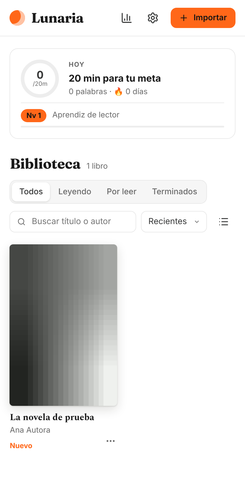
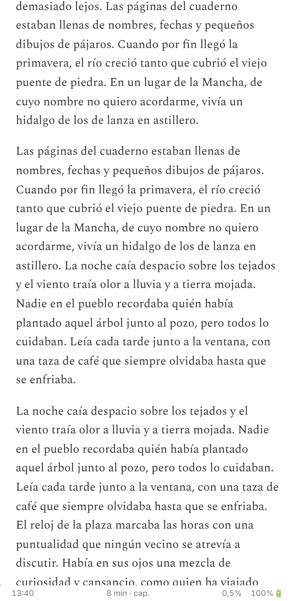
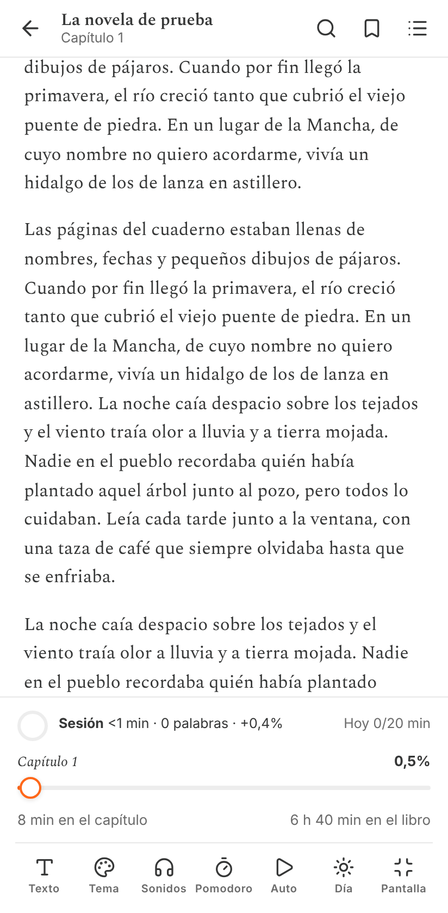
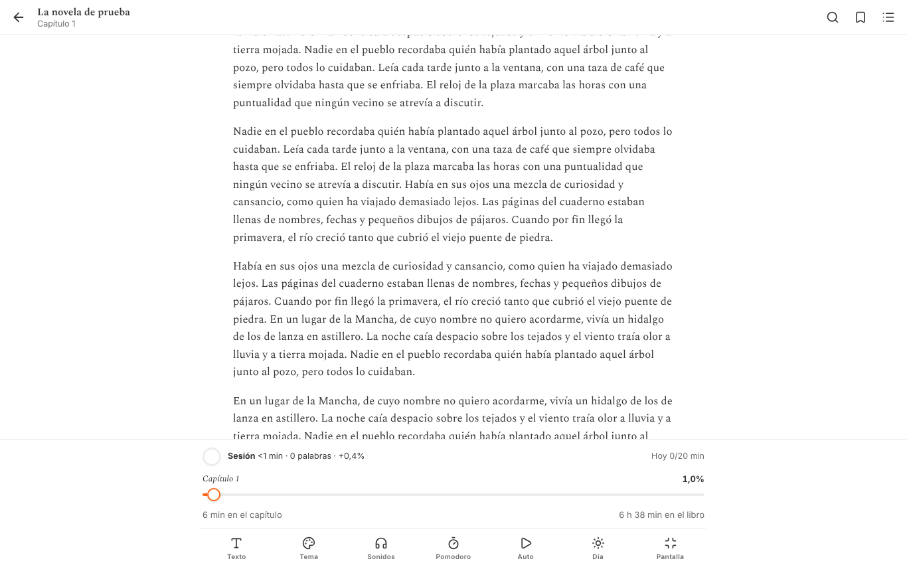

<h1 align="center">🌙 Lunaria</h1>

<p align="center">
  <b>Your books. Your pace.</b><br>
  An offline EPUB reader with infinite scroll, a pomodoro timer, synthesized rain 🌧️ and a gamification layer that rewards you for actually reading.
</p>

<p align="center">
  <a href="https://github.com/barraco002/epub-lector-/actions/workflows/build.yml"></a>
  <a href="https://github.com/barraco002/epub-lector-/releases/latest"></a>
  <a href="LICENSE"></a>
  
  
  
  
</p>

<p align="center">
  🇬🇧 English · 🇪🇸 <a href="README.es.md">Leer en español</a>
</p>

<p align="center">
  
  
  
</p>
<p align="center">
  
</p>

## 🚀 Why Lunaria?

Most EPUB readers want your attention, your email and your credit card. Lunaria just wants your next chapter. 📖

- 🌊 **Infinite scroll.** No page flips, no chapter walls.
- 🍅 **Pomodoro built in.** A countdown in your notification bar and an alarm that still rings with the screen off.
- 🌧️ **13 ambient sounds generated on your device.** Rain, thunder, fireplace, brown noise, and the eternal debate of white vs. pink.
- 🎮 **Gamified reading.** XP, levels, streaks and 22 achievements. Skipping chapters doesn't count. We're not monsters.
- 🎨 **55 themes and 27 fonts.** Paper textures included, because a reader should feel like a book.
- 🔒 **Zero accounts, zero ads, zero analytics.** Your library lives in your browser. We don't even have a server to lose it on. 🙃

## 📦 Download

Grab the latest build from **[Releases](https://github.com/barraco002/epub-lector-/releases/latest)**:

| Platform | File | How |
|---|---|---|
| 📱 Android 7+ | `Lunaria-x.y.z.apk` | Download, tap, allow "install unknown apps" once, enjoy. |
| 💻 Windows · macOS · Linux | `Lunaria-x.y.z.html` | Double-click. Works offline. No installer, no drama. |

> 💡 On Android you can also open an `.epub` from your file manager, Drive or Telegram with **Open with → Lunaria**, or share it straight into the app.

## ✨ Features

### 📖 Reading
- Continuous scroll across chapters. Only the chapters near your viewport are kept in memory.
- Tap the top or left to go back a screen, the bottom or right to go forward, the center to open the menu. Volume keys turn the page on Android.
- Autoscroll at your words-per-minute, continuous or screen by screen. Tap to pause. Volume keys adjust the speed.
- Your position is saved per character, so it survives font and size changes.
- Table of contents, bookmarks, and search that ignores accents and case.
- Highlights in five colours with notes, exportable to Markdown.
- Footnotes in a pop-up, images in a viewer.
- Dictionary (Free Dictionary, Wiktionary) and translation (MyMemory), only when you ask for them.
- A "back after a jump" chip and a "you were here" mark after each screen.
- **My words:** save a word with its sentence from the book and review it with spaced-repetition cards (boxes from 1 to 32 days).

### 🎨 Personalization
- 55 built-in themes, a theme editor (create, duplicate, export, import) and paper, linen and grain textures.
- 27 font families bundled for offline use (Spectral, Literata, Charis SIL, OpenDyslexic, Atkinson Hyperlegible…), plus your own `.ttf`, `.otf` or `.woff2`.
- Size, weight, line height, paragraph spacing, indent, letter and word spacing, margins, justification, hyphenation, and line length measured in characters.
- Respect or override the book's own fonts, colours and spacing.
- A day and night pair of themes: switch by hand, follow the system, or follow a schedule.
- A blue-light filter that warms colours and images without putting overlays on top.

### 🍅 Focus
- Pomodoro with configurable phases, a long break every N rounds, auto-start, and a 20-20-20 break screen.
- 13 synthesized sounds you can mix: rain, rain on the window, thunderstorm, wind, waves, fireplace, forest, crickets, brook, fan, and white, pink and brown noise.
- A sleep timer, and a "focus only" mode for the sounds.

### 🎮 Gamification
- XP for words read, with a speed cap so skipping chapters doesn't count.
- XP for pomodoros, finished chapters and finished books.
- Levels with titles (from *Library Mouse* upwards), a daily streak with freezes, and a daily goal in minutes.
- 22 achievements, an 18-week heatmap, reading speed and minutes per day.
- Game mode: **full**, **quiet** (nothing interrupts you, achievements wait until you close the book) or **data only**.
- A session summary when you close a book, and an *ex libris* card with a shareable PNG when you finish one.

### 📱 Android extras
- App shortcuts: Continue, Pomodoro, Rain.
- A widget with your streak, today's goal and the book you're reading.
- The pomodoro countdown lives in the notification, and an alarm rings when a phase ends, even with the screen off.
- Ambient sound can keep playing with the screen off, with a Pause button in the notification. It pauses on calls, when other music starts, or when the headphones come out.
- Automatic Android backup of progress, streaks, highlights and words (not the EPUB files), restored when you reinstall or switch phones.

## ⚡ Performance (yes, we measured it, nerds)

Measured with Chromium and the CPU throttled 4× (roughly a mid-range phone):

| Test | Result |
|---|---|
| Import *Moby-Dick* (135 chapters) | 1.3 s |
| Open it | 0.9 s |
| Reader idle for 10 s | 12 ms of CPU, 0 layout recalculations |
| Scroll | 60 fps (p95: 16.8 ms per frame) |
| Ambient sound playing | 90 ms of main thread every 10 s |
| JS heap with a book open | ~4 MB |

How we got there: no animation loops unless autoscroll is running. On Android the pomodoro uses no service while the app is closed: the system draws the countdown and a single alarm rings at the end. Sounds are generated once in a Web Worker and then looped, and the `AudioContext` suspends as soon as nothing is playing. Everything pauses when you leave the app.

## 🔒 Privacy

Everything lives on your device, in IndexedDB. No accounts, no analytics, no ads. The network is only touched when you explicitly ask for a definition or a translation. **Settings → Your data** exports and imports a backup (progress, highlights, stats, themes), so you can move to another device.

## 🧪 Quality (the part where we brag)

- **94 unit tests** (Vitest) and **32 end-to-end runs** (Playwright, mobile and desktop viewports).
- TypeScript in strict mode.
- Every push runs: typecheck → unit tests → build → Playwright → APK build → release.

## 🛠️ Development

Requires **Node 22**.

```bash
npm install
npm run dev                    # dev server
npm run typecheck              # TypeScript
npm test                       # unit tests (Vitest)
npm run build && npm run e2e   # browser tests (Playwright)
npm run build:single           # dist-single/index.html, the desktop build
npm run android:apk            # Android APK (needs the Android SDK and Java 21)
```

Project map:

| Path | What lives there |
|---|---|
| `src/lib/epub` | EPUB parsing, HTML sanitizing, isolation of the book's CSS |
| `src/lib/reader` | Scroll engine, autoscroll, reading sessions |
| `src/lib/audio` | Sound synthesis, baked once in a Web Worker |
| `src/lib/game` | XP, levels, achievements |
| `src/components` | The UI, in Preact |
| `android/` | The Capacitor project and the native `LunariaPlugin` |

Engineering notes (in Spanish, sorry): [`aprendizaje.md`](aprendizaje.md). Decisions, trade-offs and the things that went wrong along the way.

## 🔏 Signing (the honest section 😅)

Release APKs are signed with a key committed to this repository (`android/keystore/lunaria.p12`), so each release updates the previous one in place. Because the repository is public, **anyone can sign with that key**. Treat any APK that doesn't come from the [Releases](https://github.com/barraco002/epub-lector-/releases) page as untrusted. Maintainers who want their own key can set four CI secrets. The steps are in the "Firma del APK" section of [README.es.md](README.es.md#firma-del-apk).

## 🗺️ Roadmap

Ideas, not promises. 🤞

- [x] Infinite-scroll EPUB reader
- [x] Android APK and a single-file desktop build
- [x] Pomodoro with an alarm and background sound
- [x] Vocabulary with spaced repetition
- [ ] English UI (the app is Spanish-only today)
- [ ] Accessibility audit with screen readers
- [ ] Optional encrypted backup to a folder of your choice

## 🤝 Contributing

Contributions are very welcome: bug reports, feature ideas, translations, tests for weird EPUBs, or a tiny typo fix. Start with [CONTRIBUTING.md](CONTRIBUTING.md). 🎉

## 🙏 Acknowledgements

- **Moon+ Reader**, the reading experience that set the bar. 🌕
- **Substack**, for the aesthetic (and the Spectral font).
- [foliate-js](https://github.com/johnfactotum/foliate-js) (MIT), the ideas behind the EPUB parser.
- [Fontsource](https://fontsource.org), the bundled fonts, under the SIL Open Font License.
- [Lucide](https://lucide.dev) icons (ISC).
- [Preact](https://preactjs.com), [Vite](https://vitejs.dev), [Capacitor](https://capacitorjs.com), [Playwright](https://playwright.dev) and [Vitest](https://vitest.dev): the stack that does the heavy lifting.

## 📄 License

Released under the [MIT License](LICENSE). Use it, fork it, ship it. A mention is appreciated but not required. 💜

---

<p align="center">
  Made with ❤️, TypeScript, Preact and a suspicious amount of ☕.<br>
  If Lunaria made your reading a little better, <b>give it a ⭐</b>. It takes one click and makes a maintainer's whole week. 🌟
</p>
